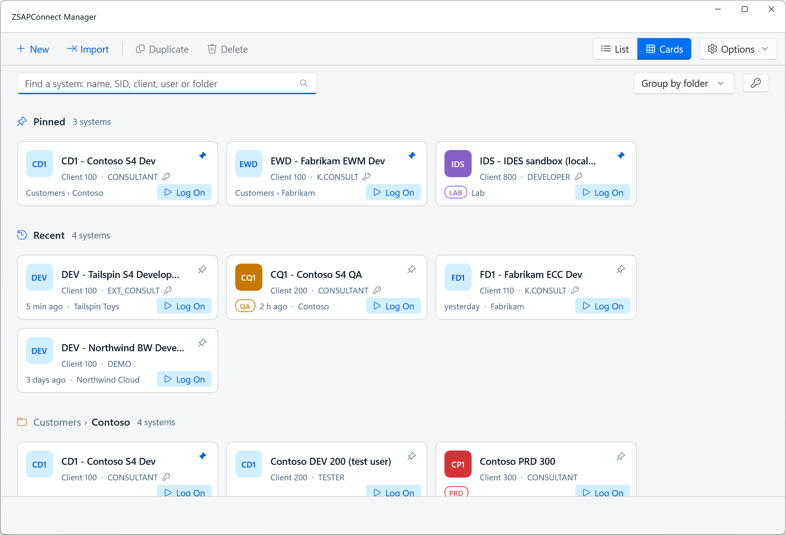
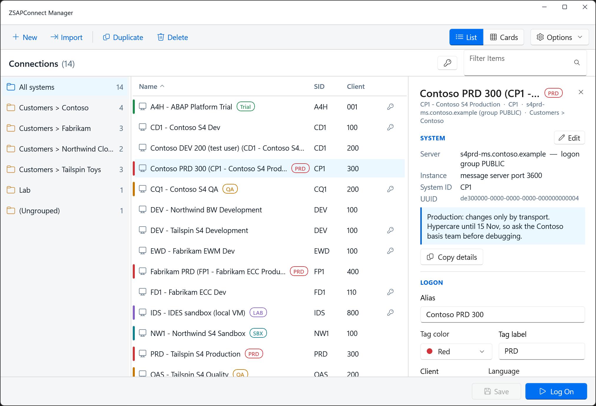
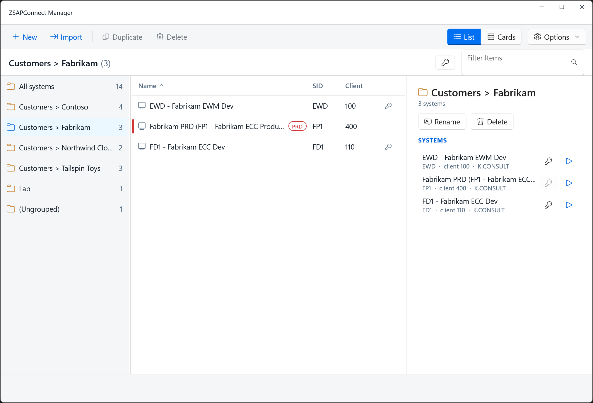
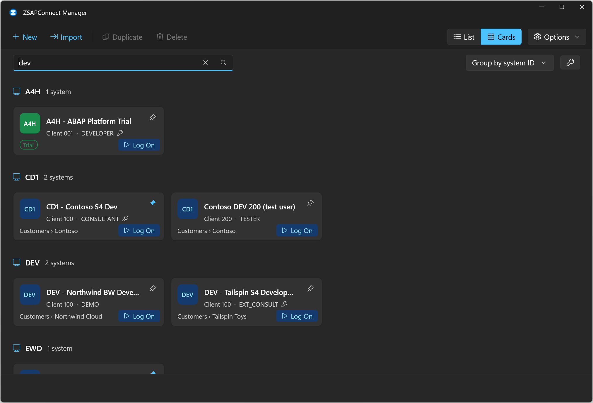

# ZSAPConnect Manager — Releases

Official download channel for **ZSAPConnect Manager**, a lightweight, native
Windows tool for SAP consultants who juggle many systems across many customers
— each with its own client, user, password, and VPN. Import your SAP Logon
landscape, keep per-system credentials in the Windows Credential Manager, and
log on with one click.

This repository hosts the release binaries only; the source code is currently
in a private repository (open-sourcing is under consideration).



*All screenshots show synthetic demo data.*

## Install

**Requirements:** Windows 10 version 1809 (build 17763) or later, x64.

**Recommended — via winget** (built into Windows 10/11):

```
winget install kts982.ZSAPConnect
```

Upgrades arrive through the same channel: `winget upgrade kts982.ZSAPConnect`.
The app checks once a day whether winget offers a newer version and, if so,
shows the command to copy (**Options → Updates**).

**Manual download** — from the
[latest release](https://github.com/kts982/zsapconnect-releases/releases/latest):

- **`ZSAPConnect-Setup-X.Y.Z.exe`** (~45 MB) — per-user installer,
  **no admin rights required**; adds a Start-menu shortcut and an uninstaller.
  Uninstalling keeps your entries and stored passwords, so upgrades are safe.
  This is the same installer winget uses.
- **`ZSAPConnect-vX.Y.Z-win-x64.zip`** (~68 MB) — portable: unzip anywhere and
  run `ZSAPConnect.App.exe`.

Both are self-contained — no .NET or Windows App SDK installation needed.

The binaries are currently unsigned, so Windows SmartScreen may show an
"unknown publisher" prompt the first time you run a manually downloaded
installer (**More info → Run anyway**).

## Features

- **Two views.** *Cards*: pinned systems and your recent logons first, then
  your systems grouped by SAP Logon folder or by system ID — the same SID at
  different customers side by side. *List*: folders, table and details, like
  SAP Logon. Switch with **List | Cards** in the toolbar.
- **Find and log on from the keyboard:** type to search by name, SID, client,
  user or folder, then pick a system with the arrow keys and press Enter.
- **Import from SAP Logon** (`SAPUILandscape.xml`) — direct application
  servers, load-balanced systems (message server + logon group), SAProuter
  routes, and folders. Importing again updates changed connections, also in
  the entries you duplicated from them, and keeps your clients, users,
  passwords, tags and pins.
- **One-click logon** via SAP GUI Scripting (COM) when available, otherwise
  launch + auto-type into the new login window only.
- **Several logons per system:** duplicate an entry for another client or
  user.
- Per-system alias, client, user, logon language, VPN note, notes, groups,
  and color/label tags ("PRD", "SBX", …).
- **Two styles:** SAP (Horizon) and Windows, each light, dark or automatic.
- SAP-compliant password generator; encrypted transfer bundles
  (AES-256-GCM) for moving entries and passwords to another PC.

## Screenshots

**List view** — folders, table and details: tag, production-notes callout,
one-click Log On:



**Group page** — member overview with quick connect/copy, rename and delete:



**Windows style, dark** — a search grouped by system ID: the DEV systems of
two customers side by side:



## Security & privacy

- Passwords are stored **only** in the Windows Credential Manager — never in
  files.
- All other data stays local in `%LOCALAPPDATA%\ZSAPConnect\`.
- Clipboard copies of credentials are excluded from clipboard history and
  cloud roaming, and auto-clear after 30 seconds.
- No telemetry. Besides the SAP systems you connect to, the app makes one
  anonymous request a day to GitHub to see whether a new version is out;
  nothing about you or your systems is sent. Turn it off in
  **Options → Updates**.
- The app never downloads or installs updates itself: it shows the
  `winget upgrade` command, and winget checks the installer against its
  published hash before running it.

## Feedback

Bug reports and suggestions are welcome in
[Issues](https://github.com/kts982/zsapconnect-releases/issues).

## License

The binaries are free to use; see [LICENSE.txt](LICENSE.txt). Bundled
third-party components are listed in
[THIRD-PARTY-NOTICES.txt](THIRD-PARTY-NOTICES.txt).

---

*ZSAPConnect is an independent tool, not affiliated with, endorsed by, or
supported by SAP SE. SAP, SAP GUI and SAP Logon are registered trademarks of
SAP SE.*
